

# Earning the Glance: Reasons, Display, and Actions
{: .no_toc }

{: .tip-title}
>Looking for the philosophy behind Indicators?
>
>This page is a decision guide - which category, which display style, which actions pattern. For the "why does this exist at all" thinking behind it, see [Why Salesforce Indicators](../philosophy/index.md).

Indicators give users an at-a-glance read on a record - the things they'd otherwise have to scan through all the fields on the page, scroll related lists, or run reports to find out. 

This section is all about all the tips, tricks, best practices, and gotchas we've learned over the past few years of using Salesforce Indicators. 



## Top Tips

* **Salesforce Themes:** An Indicator is configured once, but it is rendered by the Salesforce theme currently on display. The same configuration can look quite different on SLDS1, SLDS2 and dark mode, so check your configuration so it not just "works on my screen" but "works for everyone". When you choose a background, always choose the foreground and the text color with it. Use dark text on light backgrounds and white text on dark backgrounds.
* **Placement:** We recommend that Indicators are placed in the top right hand corner of a regular Salesforce Lightning record page. So the user first looks at the Record Name, and then the colors on the right hand side draw their eye to the Bundle of Indicators. The Top right hand corner of the page becomes the Action destination, the Edit button, the custom buttons, and the Indicators are all grouped in a similar location. 
* **Icon Colors:** Add a mix of Salesforce and custom colors to match your branding and create visually appealing indicators giving your users a more engaging experience. You can source icons from Salesforce SLDS, free or commercial sources, or even use Emojis. Don't use too many colors or icon styles. Try to stick with the [SLDS color palette](https://www.lightningdesignsystem.com/design-tokens/){:target="_blank"}

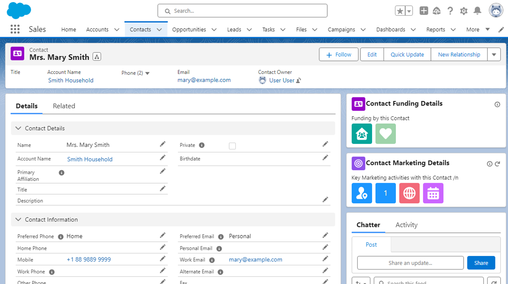{: width="590"}

{: .note-title}
>Don't overdo it!
>
>The examples and tips on this page are just a start - there are so many reasons to add an Indicator, and only you as the Admin knows your Org and your User's needs. 
>
>However, it's just as important to know when to stop. Salesforce Indicators is completely open-ended — any icon, any color, any text, any action — which means it's entirely possible to build something that no longer looks or feels like Salesforce at all. 
>
>By sticking close to the SLDS color palette, keeping actions to the handful of cases where they genuinely replace something Salesforce can't already do well, and asking "does this still help the user, or is it just decoration now?" and "do the users understand why this Indicator exists?" are what keep a page's worth of Indicators reading as **one considered system**, not a pile of unrelated icons that happened to get added over time.

{: .tip-title}
>Demo Video
>
>See some of our best tips in action on the [How I Solved It Demo](https://admin.salesforce.com/blog/2024/visualize-key-data-and-next-actions-with-salesforce-indicators-how-i-solved-it){:target="_blank"} video.

## Icons and Colors

* **Choosing icons and colors is the "art" side of Indicators:** The easiest way to get started is to use standard SLDS icons like `standard:account` and `custom:custom107`. SLDS Icons can show the Icon as designed, or you can show static text on top of the Avatar background, or override the color of the icon (💎 SLDS1 only). There is whole world of icons and images out there that you can display with Indicators - the options are endless.
* **Avoid icons already in use**: Don’t use Icons that are in use in your Salesforce org elsewhere. Eg if you have Field Service installed, then don’t use the `standard:service_crew` or `standard:service_crew_member` on Contact, as that will be confusing.
* **Don’t get too colorful:** You can really make a mess. But use specific brand icons or colors for different brands in your company for example.
* **More Tips:**
    * See [Icon Tips and Colors](icon-tips-and-colors.md) for picking a good icon and where to find one - SLDS, Salesforce logos, third party icon sites, how to load them as Static Resources, and for picking colors that work together and with the SLDS palette.

## Badges and Pills Tips and Colors

* The same Bundle can be displayed three ways using the 🆕**Indicator Style** option: **Avatar** (the original Indicators style), **Badges**, or **Pills**. 
    * **Avatars** are the simplest way to show an at-a-glance message to the User. 
    * **Badges** are best for statuses and soft exceptions like an Info, Warning, or Error badge on the page. 
    * **Pills** are best for when the Users would prefer to see text with the icons for more meaning. 
* See [Badges and Pills](badges-and-pills.md) for more tips, a suggested Badge color scheme, and icon tips for Badges and Pills. See the [Gallery of Indicator Styles and Themes](#gallery-of-indicator-styles-and-themes) below for what each style looks like.

## Bundle Tips
* Decide which Indicators work best together in the same Bundle. 
    * Informational - at-a-glance what this record is about (eg our Sample Indicators)
    * Soft Exceptions - what is preventing the record from moving to the next step, what are you waiting on?
    * Near the Data - add a Bundle onto a tab, or above the set of fields that control the Indicators on the Bundle (when using Dynamic Forms)
    * Display Multiple - an icon for every product this customer has bought, or an icon for every event this contact has attended this year. 
* See [Bundle Tips](bundle-tips.md) for Bundle placement, design, and composition tips, and many more ideas.

## Field and Formula Tips

The basis of a good Indicator is a good field. 
* Create a series of "Is Fields" - build all the business rules into what makes an Account Active into one field, and name it *Is Active*, and build all reports and filters on that one Field.
* Make the field multi-use, have it both show an Indicator *and* be visible on a Report or List View.
    * Top Tip! If you use DLRS or a Before-Save Flow, stick the value into a text field, set it to be read only, and add it to a List View, that way your Users can use that field in a search filter on the List View. 
* Multi Select Picklists are widely not recommend, yet they are widely implemented in real orgs. So using the values in a MSP as [Indicator Item Extensions](../setup/item-extension.md) may help to surface the gold hidden away inside the MSP fields.  
* See [Field and Formula Tips](field-and-formula-tips.md) for formula field ideas, including rollups.

## Accessibility Tips

* Accessibility is a shared responsibility. Salesforce Indicators is built on standard Salesforce Lightning base components, but it can’t know what your colors, icons, and text mean to your users - only you can.
* See [Accessibility Tips](accessibility-tips.md) for what Indicators gives you to work with, and what's up to you as the Admin.

## Display Multiple Tips

* Display Multiple is an excellent feature that works really well Multi Select Picklists or DLRS rollups.
* Show an icon for every service a client has an Active Contract for. 
* Show an icon for all of the channels this contact is active on. 
* See [Display Multiple](display-multiple.md) for more tips and ideas for using Display Multiple.

## Indicator Actions Tips

* Actions are set up on the **Indicator Bundle Item**, so the same Indicator can have a different action (or none) in each Bundle. Eg
    * A link to the report specifically for the currency of the logged in user, or the currency of the record. 
    * A link to the report of Campaigns this Contact have been involved in that are either for the Events team or the Marketing team.
    * A Indicator to show that a document is ready to generate, and the link goes to the correctly formatted document for that User or team.  
* Open a Flow to kick off the process that is "Next Up", so Users don't have to search for the button or link. 
* An Indicator with the No. of recently clicked on Marketing emails with a link to the report showing the detail. 
* See 🆕[Indicator Actions](actions.md) The Actions page covers which display style suits which kind of action, the action fields, and four worked examples.

{: .info-title}
>In Progress
>
>We're working on some more documentation on where Actions should and shouldn't be used. The short version for now is on the [Actions](actions.md) page - use Actions on purpose, not by default.

## SLDS1 and SLDS2 Known Differences

* Salesforce Indicators works with both the original Lightning Design System (SLDS1) and the new SLDS2, and mostly looks the same either way. 
* See [SLDS1 and SLDS2](slds2.md) for the full list of differences to plan for - Avatar shapes, icon color overrides, Badges and Pills, and Dark Mode.

## Bring your data alive!

* **Make it stand out:** Icons and colors help your data stand out, for example, you could use a $$$ icon to show that a contact is a high value donor. You can even use your own icons and branding to provide a familiar user experience.
* **Highlight the important:** Highlight important at-a-glance information, for example flag contacts that have not opted into receiving communications.
* **Summarize related records:** For example use icons on the Account record page to flag that it has open cases or overdue payments. 
* **Multi select picklists:** Highlight multi select picklist values with their own individual icon to get an overview, for example group together all the values from a product interest field to get a full picture of what an individual is interested in.
* **Make exceptions visible:** For example if there is a combination of field values making moving the record to the next stage impossible. 

### An Account Example
{: .no_toc }

The [Themes](../philosophy/index.md#themes) on the Why Salesforce Indicators page describe *what* each category of Indicator does. Here's how each one could look on a single Account record, and the field behind it.

* **Informational:** Show the Account's Industry and Type fields as icons on the record page, so reps immediately know what kind of business they're looking at without opening the detail panel.

* **Soft Exceptions:** Use a formula field checking whether Last Activity Date is more than 60 days ago, and show a warning indicator reading "No recent activity" — not a blocker, just a nudge that the Account may be going cold.

* **Next Up:** Use a formula field (or a rollup) based on the Stage of the most recent related Opportunity to show "Next Step: Schedule renewal call" as a static text indicator, so the rep knows what to do without digging into the Opportunity.

* **Quantitative:** Use a rollup counting Open Opportunities related to the Account, displayed as "3 Open Deals" — an instant read on pipeline volume without running a report.

* **Qualitative:** Use the Account's Rating field (Hot/Warm/Cold) mapped to a colored indicator so the temperature of the relationship registers before anyone reads a word.

* **Multiple:** Use a rollup that concatenates all distinct Product Family values from related Opportunity Line Items, and display each as its own icon, so an Account that's bought Software, Hardware, and Support shows three icons in a row, giving the full purchase history at a glance.

* **Actions:** For an Account flagged as "Contract Expiring within 30 Days" (using a date literal like NEXT_N_DAYS:30 against a Contract End Date field), show an action button reading "Renew Contract" that launches a flow or navigates to a new Opportunity.

## Gallery of Indicator Styles and Themes

All Images are using our standard Sample Indicators on Account. Click on the Image to enlarge it to full size. 

🖼️ Avatars SLDS2 Light Mode

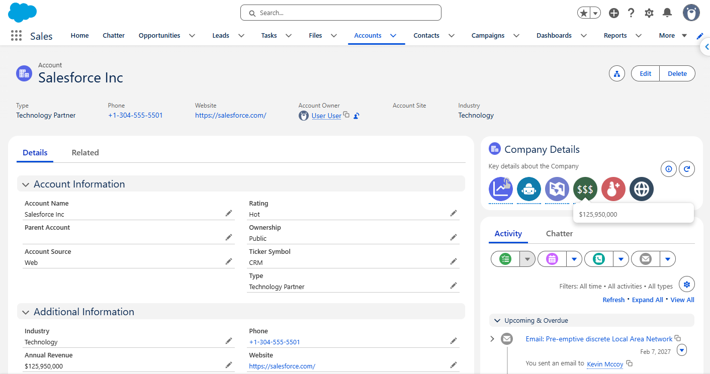{: width="800"}

🖼️ Avatars SLDS2 Dark Mode

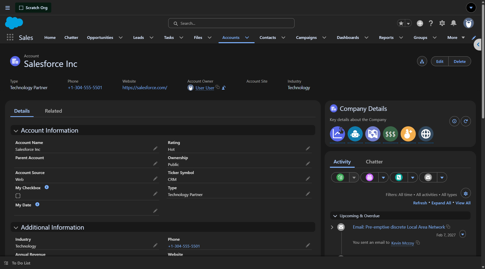{: width="800"}

🖼️ Badges SLDS2 Light Mode

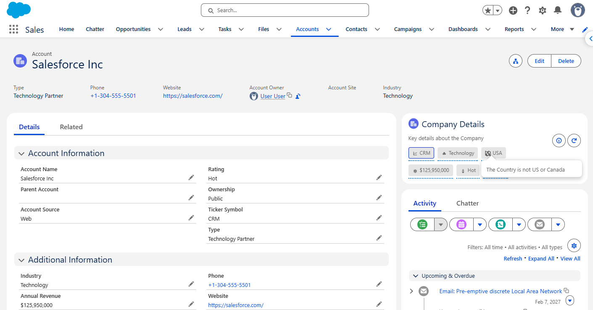{: width="800"}

🖼️ Badges SLDS2 Dark Mode

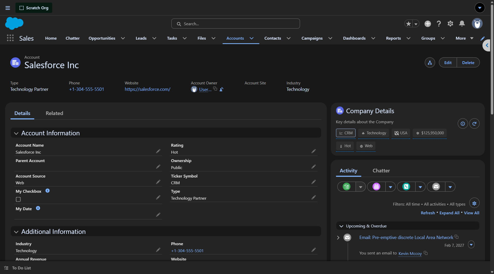{: width="800"}

🖼️ Pills SLDS2 Light Mode

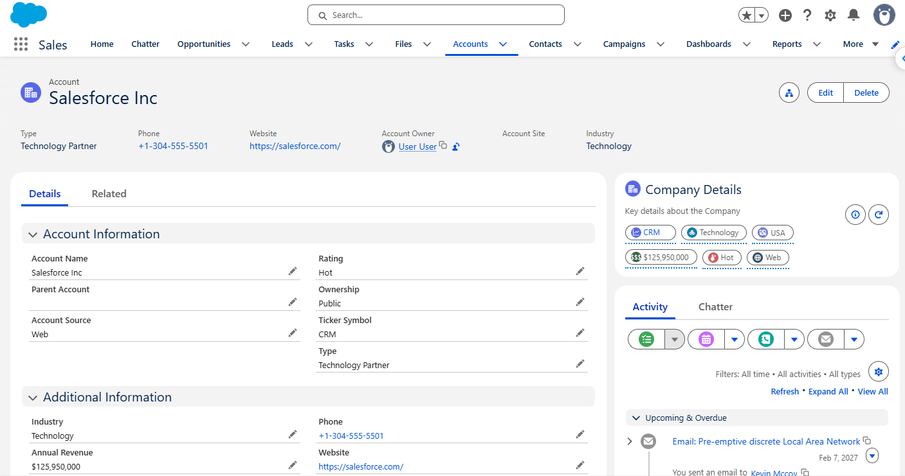{: width="800"}

🖼️ Pills SLDS2 Dark Mode

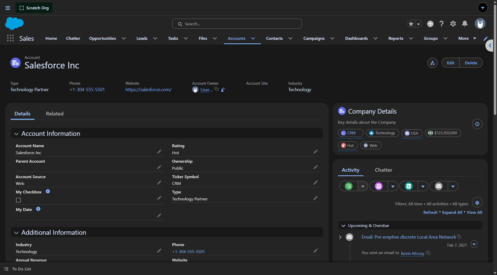{: width="800"}

🖼️ Pills in Wide Column with Dynamic Forms Style SLDS2

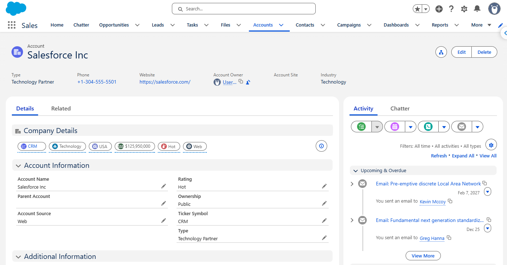{: width="800"}

🖼️ Pills in Wide Column with Dynamic Forms Style SLDS2 Dark Mode

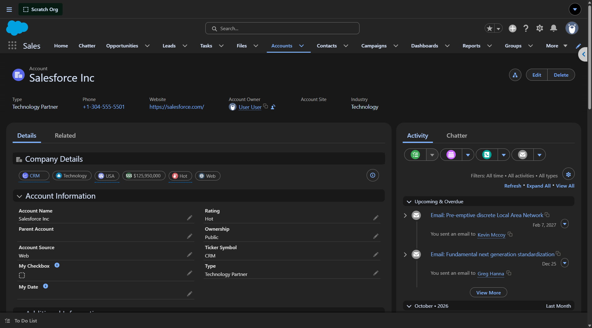{: width="800"}

🖼️ SLDS 1 Indicator Styles Comparison

💡 It's not recommended to have different views of the same Bundle on the same page — this is just handy for comparing styles while you're testing. Here are our Sample Indicators showing each style, with just a color override on one extension. 

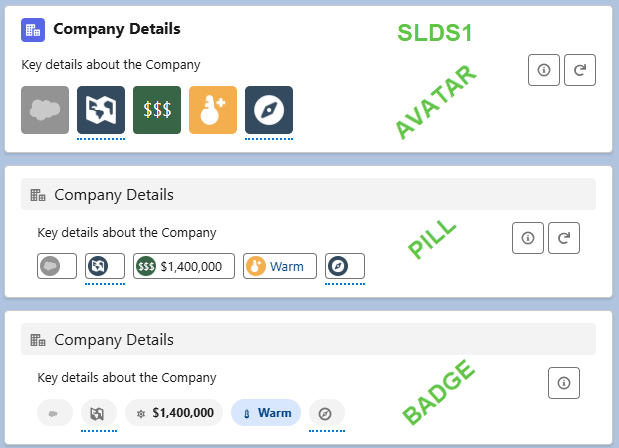{: width="800"}

🖼️ SLDS 2 Indicator Styles Comparison

💡 It's not recommended to have different views of the same Bundle on the same page — this is just handy for comparing styles while you're testing. Here are our Sample Indicators showing each style, with just a color override on one extension. 

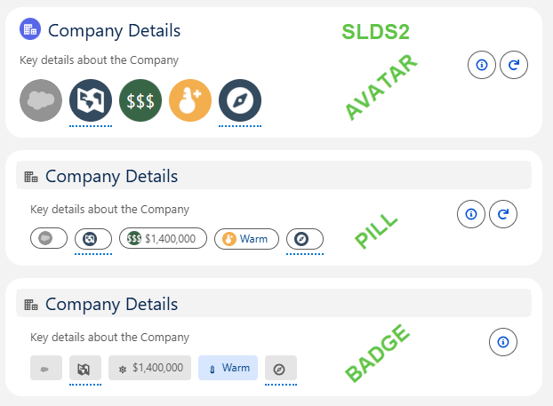{: width="800"}

## Related Content
{: .no_toc }

* 🧭 **[Path 2](../guided-pathway/enhance-your-indicators.md) >** 🆕[Actions](actions.md) the one new feature people ask about most.
* [Why Salesforce Indicators](../philosophy/index.md) for the thinking behind Indicators.

