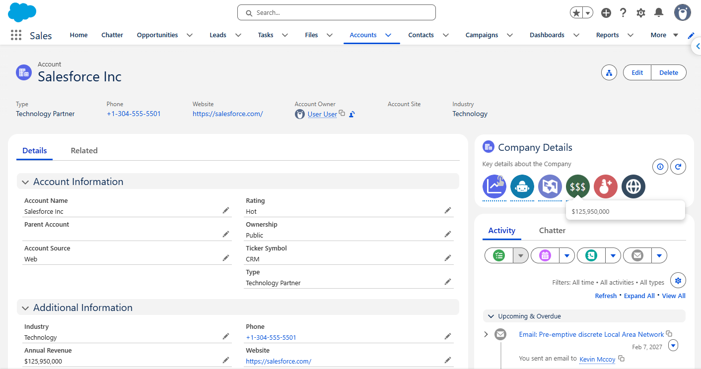
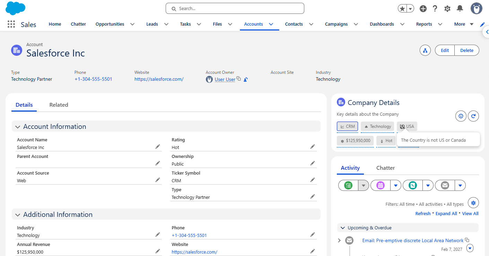
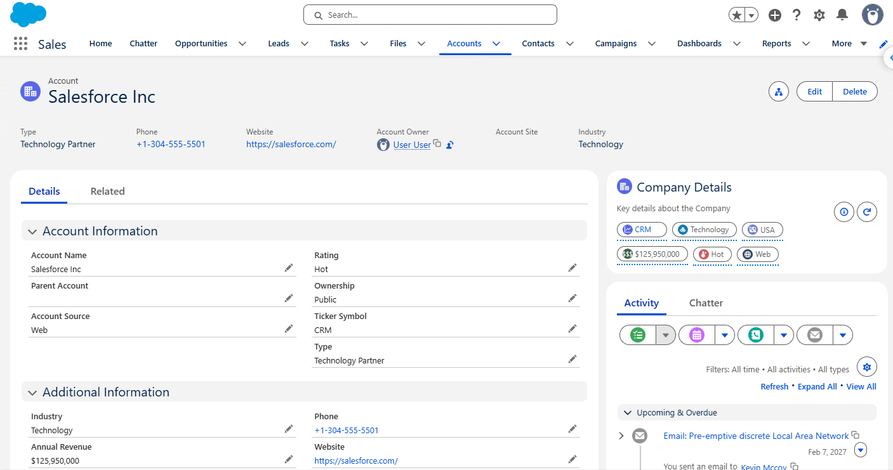
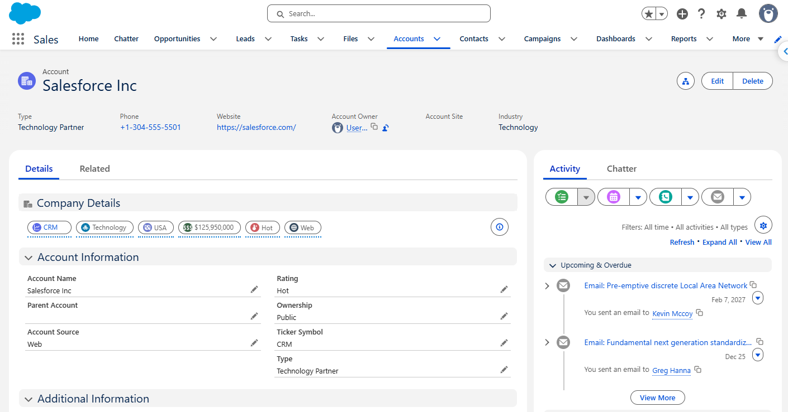
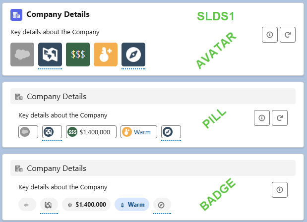
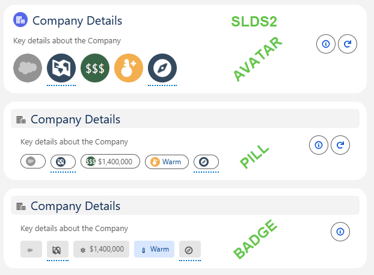





## Add the Bundle to the Lightning Page
{: .no_toc }

The [Indicator Bundle](../indicator-bundle) is added to the Lightning Record Page. You can have as many **Indicator Bundles** on Lightning Record Pages as needed. 

{: .new-title}
>🆕 Indicator Style
>
>Choose how the whole Bundle displays with the new **Indicator Style** property - **Avatar** (the original icon style), **Badges**, or **Pills**. See [Indicator Style](#indicator-style) for the details of each style.

- TOC
{:toc}

## Add the Bundle to your Lightning Page

### Basic Setup

* Edit your Lightning Record Page (eg Account), and add the **Indicator Bundle** Component by dragging it to the desired location.
    * We recommend starting with the top right hand corner of a regular Lightning Page Layout.
* Choose the **Indicator Bundle** to show on the Page (eg Account Company Details). Ensure it is the correct Bundle to display for that Object.
* Choose the **Indicator Style** - `Avatar`, `Badges`, or `Pills`. See [Indicator Style](#indicator-style) for more on each style.
* Optionally choose to **Display Title** 
* Optionally choose to **Display Description**
* Choose the **Indicator Size** - `large` or `medium` (💎Avatar only)
* Choose the **Indicator Shape** - `base` or `circle` (💎SLDS1 only, Avatar only). This only applies to the Avatar style - see [Indicator Style](#indicator-style) for how it affects Badges and Pills.

### Optional Setup Items
* Choose the **Title Style** either to look like regular Lightning Pages (similar to the Related Record Component), or to look like Dynamic Forms pages. 
* 💡 Optionally choose to show the **Refresh Button**. This is useful whilst you are setting up your Bundles. The Refresh Button will only display to those with the *Indicators Setup Access* Permission Set. 

### Mapped Id Field
* Optionally use the **Mapped Id Field** to choose to base the Indicator Bundle on a record that is a Lookup from the displayed record. Eg enter 'AccountId' to display your Account Company Details Bundle on the Contact page. 
* When the Bundle is displayed from a Related Record (Mapped Id Field), you can show a footer on the Bundle that notes which record the Bundle is based on. 
* Example: 
    * To show the Parent Account's `Account Company Info` Bundle on the Account, enter `ParentId` as the Mapped Id Field and check Show Footer.💡Hide the Bundle using *Conditional Visibility* if there is no Parent Account.
    * To show the Parent Account's Parent Account (the Grandparent Account) `Account Company Info` Bundle on the Account, enter `Parent.ParentId` as the Mapped Id Field and check Show Footer. 💡Hide the Bundle if there is no Parent Account, as there will be no Grandparent Account either. 

{: .info-title}
>In Progress
>
>Add some screen shots and explanations of where we would use the Mapped ID Field.

### Popovers for Every Indicator
* If an Indicator has no **Hover Text** and no [Action](../../best-practices/actions.md), it has no Popover. Avatars still show the name of the Indicator Item as standard alt text, but not the field value.
* 🆕 To show the field value in a Popover when **Hover Text** is blank, check **Show field value in popover when Hover Text is blank**. The field value is shown formatted. Check the functionality on Mobile after enabling this to see if this setting is right for your users. 

## Indicator Style

Set the **Indicator Style** property on the Indicator Bundle component to choose how the Bundle displays:

| Style | What it looks like | Salesforce Base Component |
|---|---|---|
| Avatar | The original squareish (SLDS1) or round (SLDS2) icons | [Avatar](https://developer.salesforce.com/docs/platform/lightning-component-reference/guide/lightning-avatar.html){:target="_blank"} |
| Pills | Rounded rectangles with an icon and text. SLDS2 is more rounded, like a Pill shape. | [Pill](https://developer.salesforce.com/docs/platform/lightning-component-reference/guide/lightning-pill.html?type=Example){:target="_blank"} |
| Badges | Rounded end rectangles with color and an optional utility icon, showing text. In SLDS2 Badges are rectangle with rounded corners. | [Badge](https://developer.salesforce.com/docs/platform/lightning-component-reference/guide/lightning-badge.html?type=Example){:target="_blank"} |

## Gallery of Indicator Styles and Themes

All Images are using our standard Sample Indicators on Account. Click on the Image to enlarge it to full size. 

🖼️ Avatars SLDS2 Light Mode

{: width="800"}

🖼️ Badges SLDS2 Light Mode

{: width="800"}

🖼️ Pills SLDS2 Light Mode

{: width="800"}

🖼️ Pills in Wide Column with Dynamic Forms Style SLDS2 

{: width="800"}

🖼️ SLDS 1 Indicator Styles Comparison

💡 It's not recommended to have different views of the same Bundle on the same page — this is just handy for comparing styles while you're testing. Here are our Sample Indicators showing each style, with just a color override on one extension. 

{: width="800"}

🖼️ SLDS 2 Indicator Styles Comparison

💡 It's not recommended to have different views of the same Bundle on the same page — this is just handy for comparing styles while you're testing. Here are our Sample Indicators showing each style, with just a color override on one extension. 

{: width="800"}

{: .tip-title}
>Badges and Pills, how to tell them apart
>
>In SLDS2, pills sort of have a pill shape. However, in SLDS1 it's opposite as Badges have a more rounded shape.

### Pills

#### When to Use Pills
{: .no_toc }

* Pills are great when users need to see the text more than the icon — the icon just gives a splash of color rather than being the main visual indicator.
* Pills work well when the Indicator doesn't have **Hover Text** set, and just displays the field value directly.

#### Things to Note
{: .no_toc }

* Avatars shown on a Pill only display as a circle in SLDS2 themes on desktop. **Avatar Indicator Shape** works on Mobile and in SLDS1 themes, on both desktop and Mobile, and can show as base (square) or circle.
* Take care with the length of **Hover Text** on Pills — it can look odd on smaller screens. Aim for 3 words max, or just let the field value show.
* Apart from the icon, Pills themselves have no color.
* Pills display with some white space after the text — this is because Pills aren't removable here (unlike when they're used for tags elsewhere in Salesforce).

{: .issue-title}
>Known Issue
>
>Pill icons are not vertically centered on Mobile when an [Action](../../best-practices/actions.md) is added to the Pill.

#### Pill Design Tips
{: .no_toc }

* Use brief, clear labels that are immediately understandable.
* Use sentence case on Pill labels, and avoid verbs.
* Avoid overusing Pills in a crowded layout — too many Pills creates visual clutter.
* Use Pills consistently across your org so users become familiar with what each one means.

### Badges

#### When to Use Badges
{: .no_toc }

* Sometimes words are better than icons — Badges provide at-a-glance information that doesn't need any extra interaction, since there's no need to hover to read them.
* Badges are great for Info, Warning, Success, and Error messages — soft alerts, like missing data, rather than static facts about the record.
* Switch things up across a page: use Icons (Avatar) for static data about the record, and Badges for the things that need attention.
* Badges look great set up with the Dynamic Forms Title Style and placed right below the section of fields they relate to.

#### Things to Note
{: .no_toc }

* Changing **Avatar Indicator Shape** and **Avatar Indicator Size** has no effect on Badges.
* Badges have square corners on desktop in SLDS2, and rounded corners on Mobile and in SLDS1 themes.
* Icons only show on a Badge if there's a Utility Icon matching a standard icon. If you need an icon on a Badge, it's best to create a separate Indicator Item just for use on Badge Bundles.
* Static Text on the Indicator displays as a cog icon on Badges, rather than the text itself.
* Badges in the SLDS spec shouldn't be used for [Actions](../../best-practices/actions.md) — there's nothing stopping you setting one up, but it's not a great user experience.
* Keep Badge text to around 1-3 words.

{: .issue-title}
>Known Issue
>
>The hover of the field name only appears if you hover directly over the icon — if there's no icon on the Badge, the field name won't be shown on hover at all, which may be an issue for screen readers.
>
>Badge icons aren't centered vertically within the Badge, and a Badge with an icon is taller than a Badge without one.

#### Badge Design Tips
{: .no_toc }

* Make sure Badges have clear, understandable text and good color contrast for accessibility.
* Use Badges consistently across your org so users become familiar with what each one means.
* Don't use too many Badges in one Bundle.

### Choosing Between Avatar, Badges, and Pills

* **Avatar** — best for at-a-glance icons where hover text gives the detail, and for a compact strip of Indicators.
* **Badges** — best when the text itself is the message (eg a status word), and users shouldn't need to hover to understand it.
* **Pills** — best when you want both an icon and visible text together, without needing a hard color association like a Badge.

You don't have to pick just one — different Bundles for the same object can use different styles depending on what they're showing.

## Next Steps

* See [Build Glanceable Indicators](../../best-practices/index.md) for more tips and tricks for placing the Indicator Bundles on the Page
* Use the New button to add a new [Indicator Item](../indicator-item), and continue to add more Items
* Use the New button to add a new [Indicator Bundle Item](../indicator-bundle-item) to link the Bundle to the Item
* Check [The Key](../the-key)
* See [SLDS1 and SLDS2](../../best-practices/slds2.md) for how Badges and Pills differ between themes.
* See 🆕[Actions](../../best-practices/actions.md) for making an Indicator clickable.
* 🧭 **[Path 2](../../guided-pathway/enhance-your-indicators.md) >** [Beyond the Record Page](../../components/flows.md)
