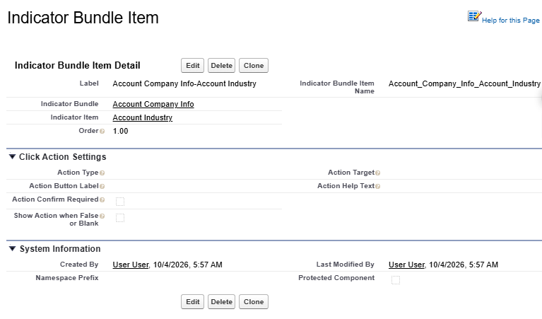





The Indicator Bundle Items link an [Indicator Item](indicator-item) to an [Indicator Bundle](indicator-bundle). This allows you to set up different bundles that will display at different times or for different sets of users, but re-use the same **Indicator Items** on multiple **Indicator Bundles**. 



## Indicator Bundle Item

An Indicator Bundle Item displays the Indicator Item on the Indicator Bundle. This allows for one Indicator Item to be created and displayed on multiple Indicator Bundles.

{: .new-title}
>🆕Click an Indicator to do something!
>
>Indicators can now have [Actions](../best-practices/actions.md)!  
>Enter a URL or a Flow name and the Avatar, Badge, or Pill Indicator turns into a button shown.
>Users click the button to be taken to another record, an external website, a report, or the button can launch a Flow or Quick Action. See the [Actions](../best-practices/actions.md) page for all the details.

## Add a new Indicator Bundle Item


## Edit an existing Indicator Bundle Item

* Go to the **Indicator Settings** Tab
  * Choose the Indicator Bundle from the drop down list. The existing bundle details will be displayed.
  * Click the **Edit Bundle** button
  * Click **Edit** next to the **Indicator Bundle Item** in the related list

OR, alternatively:

* Edit the Settings in CMDT:
  * Navigate to Salesforce **Setup** > **Custom Metadata Types**
  * Scroll to **Indicator Bundle Items**, and click **Manage Records**
  * Click **Edit** next to the Bundle Item you want to edit

## Indicator Bundle Item Fields

|Field|Example Value|Description|Tip|
|---------|----------|-------------------|--------------------------|
|**Detail Section**|
|Label|`Contact Default Mobile`|Give it a descriptive name|Include the Object Name
|Indicator Bundle Item Name|`Contact_Default_Mobile`|The API name
|Indicator Bundle|`Contact Default`|Choose the Indicator Bundle from the List|Type part of the name in the lookup fields and it will auto complete them on Save|
|Indicator Item|`Contact Mobile`|Choose the Indicator Item from the List|Type part of the name in the lookup fields and it will auto complete them on Save|
|Order|`10`|The Order this Indicator will appear in the Bundle|Use increments of 10 or more when setting up the Order, so you can add new Indicators in between without re-ordering the whole bundle. Eg 10, 20, 30, then add a new Indicator at 14 later|
|**Click Action Settings Section**|
|Action Type|`URL`|Choose **Flow (Modal)** or **URL** to make this Indicator clickable|See [Actions](../best-practices/actions.md) for full details on all the Action fields
|Action Button Label|`Open Report`|The text shown to the user on the action button
|Action Target|`/lightning/r/Report/00OXX0000000001/view?fv0={!Id}`|The flow API name, or the URL to open|Supports merge fields eg {!Name}
|Action Help Text|`Show the latest report`|Explanatory text shown when the Indicator is hovered over
|Action Confirmation Required|`false`|Whether the user must hover and click the action button, or can click the Indicator directly
|Show Action When False or Blank|`false`|Whether the Action shows even when the underlying field is false or blank

{: .tip}
>
>For **Action Targets** on Text Fields add escaped "quotation marks" around the merge field = eg `fv0=%22{!Industry}%22`.

## Custom Metadata Page Layout

{: width="800"}

## Validation Rules

* **Action Target is required with an Action Type** - If you choose an **Action Type**, **Action Target** becomes required. To disable the action while keeping Action Target configured, clear **Action Type** instead of clearing **Action Target**.
* **Bundle and Item must match** - The **Indicator Bundle** and the **Indicator Item** must be set up for the same sObject.

## Rules
* **URL** Actions open the link in a *new tab*. Merge tokens in the link are filled in from the record.
* **Flow Modal** Actions open a Screen Flow in a dialog over the Record. A flow that only displays information is the safest thing to launch from an Indicator.
* The button defaults to **Open** (URL) or **Launch** (Flow). Set the **Action Button Label** to tell the User what happens when the button is clicked.
* **Confirm Required** means clicking the Indicator itself does nothing; the user must click the button in the Popover.
* Actions are hidden when the field value is false/blank state unless you also turn on **Show False or Blank Action**.

{: .issue-title}
>Known Issues for Actions
>
>There's a brief screen flicker when displaying a Flow in a modal. See [Known Issues](../technical-documentation/known-issues.md#actions) for this and other Action known issues.

## Next Steps
* 🆕 See more details on [Actions](../best-practices/actions.md)
* Add Optional [Extensions](item-extension)
* Add the Bundle to your [Lightning Page](add-to-lightning-page.md) and check [The Key](the-key)

## Claude Notes
{: .no_toc }

{: .warning-title}
>🤖 Claude's Suggestions
>
>* **This "Rules" section substantially repeats** the "Action Confirmation Required" and "Show Action When False or Blank" explanations from [Indicator Actions](../best-practices/actions.md), just in compressed form. If that page changes how these behave, this section could quietly go stale. Consider trimming this to only what's specific to filling in the CMDT record, and linking to Actions for the "why."
>* The compact Action Fields table here duplicates the fuller [Indicator Actions > The Action Fields](../best-practices/actions.md#the-action-fields) table - reasonable to keep both (one is the CMDT reference, one is the explainer), but worth double-checking the two stay in sync when a field's behavior changes.
