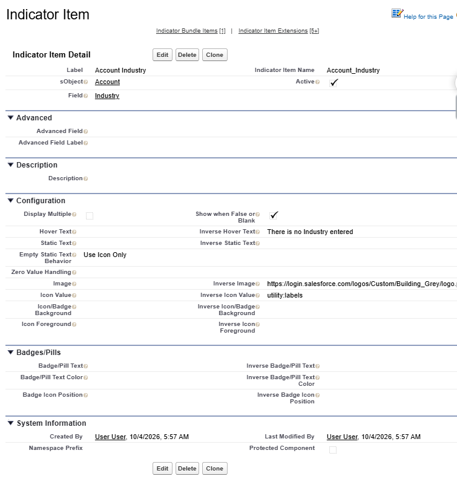





See [Indicator Bundle](indicator-bundle) to set up the **Indicator Bundle** before setting up **Indicator Items**.



## Indicator Item

An Indicator Item is setup to display an individual icon related to one field on the object. For instance, if you want to see a visual indicator to see at a glance that the Account is Active, based on the custom **Account Status** field.

## Add a new Indicator Item


## Edit an existing Indicator Item

* Go to the **Indicator Settings** Tab
  * Choose the Indicator Bundle that the Indicator Item is on (or the Item will be in *Unbundled Items* if the Item is not on a Bundle yet). 
  * Click the **Edit Indicator** button

OR, alternatively:

* Edit the Settings in CMDT:
  * Navigate to Salesforce **Setup** > **Custom Metadata Types**
  * Scroll to **Indicator Items**, and click **Manage Records**
  * Click **Edit** next to the Item you want to edit

## Indicator Item Fields

|Field|Example Value|Description|Tip|
|---------|----------|-----------------|----------------------------|
|**Detail Section**|
|Label|`Contact Mobile`|Give it a descriptive name|Include the Object Name
|Indicator Item Name|`Contact_Mobile`|The API name
|sObject|`Contact`|Choose the Object whose values this Indicator references
|Field|`Mobile Phone`|Choose the Field whose values this indicator references
|Active|`true`||Leave this unchecked until the Indicator is ready to be displayed on a Bundle
|**Advanced Section**|
|Advanced Field||To use a field from a record higher in the parent-child relationship, directly enter the spanning fields (up to 5 level away). Example:  `Contact.Account.Owner.FirstName`|Ensure the field syntax is correct, there is no validation - the Indicator will just not display or may cause an error in the component. **Advanced Field** is an advanced option, use it with caution!|
|Advanced Field Label| |Enter the Label to be displayed in The Key for this Field. Example: `Account Owner First Name`
|**Description Section**|
|Description|`If the Contact's Mobile is Entered the icon will show`||Write something useful here, your future self will thank you
|**Configuration Section**|||💡 When using [Extensions](item-extension) the Configuration section can be left blank|
|Display Multiple| `false`| Should ALL the Extension icons be displayed? |When Multiple Extensions are configured, instead of showing only one Icon based on the Priority order, show all configured Extension Icons. See Extensions for more details.
|Hover Text|`The Contact has a Mobile Phone No. entered`|Text to display in a popover when the user hovers over the icon|🆕Hover Text is now a Popover and works for Mobile. The **Indicator Name** shows for screen readers. 🆕Hover text can include Merge Fields eg `{!Name}`. 🆕Optionally, To show Field Values in Popovers if there is no **Hover Text** entered, set **Show field value in popover when Hover Text is blank** when [Add the Bundle to the Lightning Page](add-to-lightning-page.md#optional-setup-items).
|Static Text||Text to display instead of a field value, icon, or image URL (only the first 3 characters or 1 emoji will display). 
|Empty Static Text Behavior||Choose an option to use in place of static text, when indicator is false or blank|Default is `Use Icon Only` which will show the Icon if there is no Static Text entered. This field controls both regular and Inverse selections. Note: When using an Image this field is not used
|Zero Value Handling||How to treat Zeros (as blank or number)|Use in conjunction with Show when False or Blank
|Image||The URL to the image of the Indicator when being used instead of Field, Text, or Icon|eg link to a Static Resource, File, or Document in your Org. The use of an Image overrides any Icon settings
|Icon Value|`custom:custom28`|The Lightning Design System icon when being used instead of Field, Text, or Image URL. Get Icons from from [SLDS Icons](https://lightningdesignsystem.com/icons/){:target="_blank"}. Enter the full category and icon name like `custom:custom32`|If Static text is entered, the Icon color will be used, with the static text in white
|Icon/Badge Background| |The color to display for the Icon's background|💎SLDS1 Only. 🆕Handles Badges also 
|Icon Foreground| |The color to display for the Icon's background|💎SLDS1 Only
|**Configuration - Inverse Section**|
|Show when False or Blank|`false`|Should this indicator display anything when the field is false or blank?
Inverse Hover Text||The hover text when the indicator is false or blank. 🆕Hover text can use Merge Fields eg {!Name}.
Inverse Static Text||The static text to use when false or blank
Inverse Image||The URL to the image of the Indicator when being used instead of Field, Text, or Icon for false or blank values
Inverse Icon Value||The Lightning Design System icon when being used instead of Field, Text, or Image URL for false or blank values 
Inverse Icon/Badge Background| |The color to display for the Icon's background when the value is false or blank|💎SLDS1 Only. 🆕Handles Badges also
Inverse Icon Foreground| |The color to display for the Icon's background when the value is false or blank|💎SLDS1 Only
|**🆕Badges/Pills Section**|
|Badge/Pill Text| |The text that will show in conjunction with the Icon on a Badge or Pill style Indicator|🆕This allows Text to be shown on Badges and Text + the icon to be shown on Pills.
|Badge/Pill Text Color| |The color to display for the Badge or Pill text|💎Works for SLDS1 and SLDS2!
|Badge Icon Position | |For Badges only, the icon can be left or right
|**🆕Badges/Pills - Inverse Section**|
|Inverse Badge/Pill Text| |The text that will show in conjunction with the Icon on a Badge or Pill style Indicator|🆕This allows Text to be shown on Badges and Text + the icon to be shown on Pills.
|Inverse Badge/Pill Text Color| |The color to display for the Badge or Pill text when the value is false or blank.
|Inverse Badge Icon Position | |For Badges only, the icon can be left or right

## Custom Metadata Page Layout

{: width="800"}

{: .tip-title}
>Setup Tips
>
>See the Examples and Recipes in this documentation for ideas on how to use these settings.
>See [Build Glanceable Indicators](../best-practices/index.md) for many more tips and tricks for Indicator Items, Icons, and Colors.

{: .warning-title}
>Things to Note
>
>When **Hover Text** is blank, the **Indicator Name** shows as a standard Tooltip. When **Hover Text** is entered, the Popover displays over the top of the Tooltip, rather than replacing it. The Tooltip is important for screen readers. 🆕Optionally, To show Field Values in Popovers if there is no **Hover Text** entered, set **Show field value in popover when Hover Text is blank** when [Add the Bundle to the Lightning Page](add-to-lightning-page.md#optional-setup-items).

## Validation Rules

* **Object is required** - An **sObject** must be assigned, or the Item has nothing to render on the page.
* **Only one field mapping** - Provide either a **Field** selection in the picklist or an **Advanced Field** value - not both, and not neither. The component needs exactly one way to know which field to read.
* **Icon syntax must match SLDS** - **Icon Value** must start with `standard:`, `custom:`, `utility:`, `doctype:`, or `action:`, followed by a colon and the icon's API name.
  * Same as above, but for **Inverse Icon Value**.
* **Fallback icon required with an Image** - If you enter an **Image**, also enter an **Icon Value** as a fallback in case the image source fails to load.
  * Same as above, but for **Inverse Image** and **Inverse Icon Value**.
* **Empty Static Text needs a behavior** - If **Static Text** is blank, choose an **Empty Static Text Behavior** so the component knows what to show instead.

## Rules
* The indicators work with Boolean or Text fields. 
  * Dates and Numbers can be used in [Extensions](item-extension.md) to show an Indicator based on a 🆕date range or numeric range. 
* If the field is a Boolean and the value is False the Indicator will not show unless **Show When False or Blank** is checked an an **Inverse Icon Value** is entered.
* If the field is a Boolean and there is a value in **Static Text** then that text will show. Limit this text to 3 characters max. 
* If the field is a Boolean and there is no value in **Static Text** the Icon will be shown.
* If the field is a Text field and there is no value in **Static Text**, and an **Icon Value** is entered the first 3 characters of the field value will show as Static Text.
* If there is **Static Text**, the Icon image will not be shown, but the color will be from the **Icon Value** entered. 
* If there is a value in **Image** that image will show. Use **Inverse Image** to show Images for False values.
  * **Image** will take precedence over **Icon Value**. The Icon will display if the Image can't be loaded. 
* What Displays on the Badge or Pill is **Badge/Pill Text**, which is separate from **Hover Text** the order of what is shown on the Badge or Pill is:
  * A matching extension's **Badge/Pill Text**
  * The item's **Badge/Pill Text**
  * The field's value, formatted, (if **Show field value in popover when Hover Text is blank** on the [Indicator Bundle component](add-to-lightning-page.md#popovers-for-every-indicator) is set).
  * The **Badge/Pill Text** and the **Hover Text** can include the merge value of the field (eg `{!AnnualRevenue}`)

{: .issue-title}
>Known Issues for Icons
>
>Action Icons don't render correctly on Avatars, and Standard/Custom icon color overrides don't work in SLDS2 yet. See [SLDS1 and SLDS2](../best-practices/slds2.md#known-differences) for the details and workarounds.

## Next Steps
* Add Optional [Extensions](item-extension)
* Add the Indicator to a Bundle using [Indicator Bundle Items](indicator-bundle-item)
